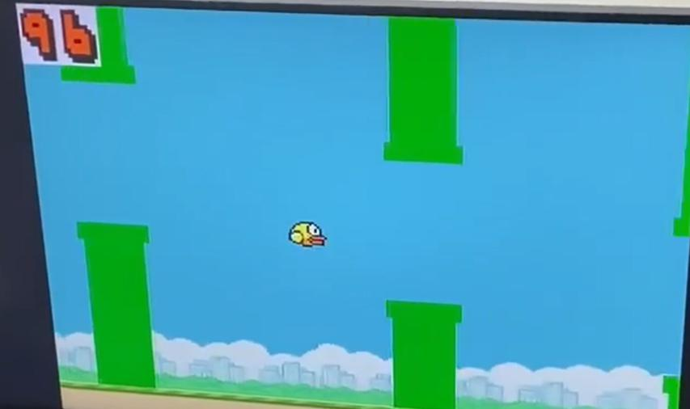
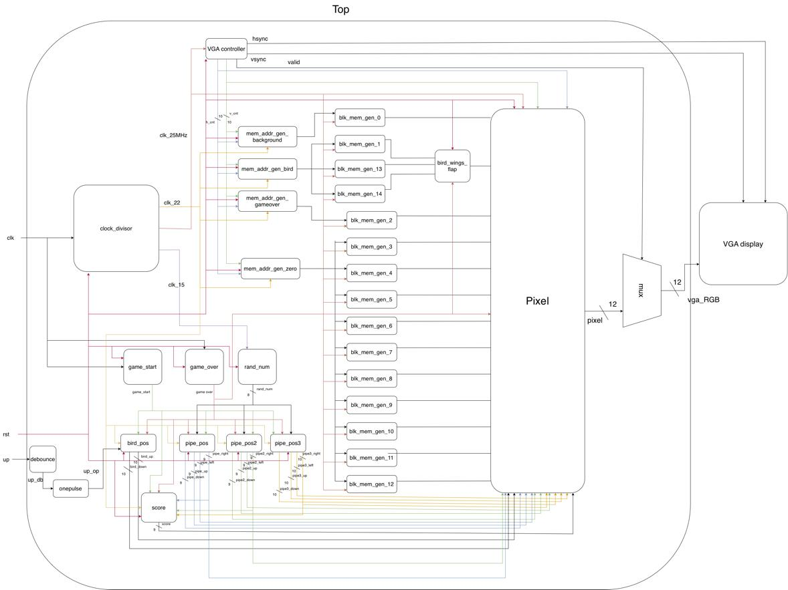

# Flappy Bird on FPGA (Basys 3)

A complete Flappy Bird game written in Verilog and run on a **Digilent Basys 3** board (Xilinx Artix-7 `xc7a35tcpg236-1`). The game is displayed through **VGA at 640×480** and controlled with the board's buttons. It was the final project of an undergraduate Logic Design Lab course, built by a team of two.

*Photo of the game running on the board, taken from the project report. This is an earlier version: the final version shows a score of up to three digits and uses slightly different pipe colors.*

## Gameplay

| Input | Basys 3 button | Function |
|---|---|---|
| `up` | right button (T17) | start the game / make the bird jump |
| `rst` | bottom button (U17) | reset to the start screen |

1. **Start screen:** only the background scrolls.
2. **Playing:** pressing the right button starts the game; three pipes scroll in from the right and the bird falls under gravity unless you press jump. Each pipe passed adds one point.
3. **Game over:** touching a pipe or the ground shows the "Game Over" banner. Press reset to play again.

## Design overview

| Module (file) | Role |
|---|---|
| `top` | Top level: game state (start / over), collision check, wiring of all modules |
| `vga_controller` (`vga.v`) | 640×480 VGA timing, outputs `h_cnt`, `v_cnt`, `valid` |
| `clock_divisor` | Derives the 25 MHz pixel clock, the ~24 Hz game tick (`clk22`) and a faster clock for the LFSR (`clk15`) from the 100 MHz board clock |
| `debounce`, `onepulse` | Clean the button input and turn a press into a single pulse |
| `randnum` | 8-bit LFSR pseudo-random number generator |
| `pipe_pos`, `pipe2_pos`, `pipe3_pos` | Position, scrolling and gap height of the three pipe pairs |
| `bird_pos` | Bird position with an initial upward speed and constant downward acceleration |
| `bird_wings_flap` | Chooses the wing-up / wing-down / dead bird sprite |
| `score` | Counts pipes that the bird passed |
| `mem_addr_gen_*` | Convert screen coordinates into sprite memory addresses (background scrolling, bird, game over, digits) |
| `Pixel` | Selects which pixel (background, bird, pipes, digits, game over) is sent to VGA; the purple sprite background is treated as transparent |

Technical notes:

- **Sprites in on-chip block RAM.** The background, three bird sprites, ten digits and the game-over banner are stored in Block Memory Generator ROMs initialised from `.coe` files (12-bit color).
- **Pixel pipeline.** At every pixel the VGA coordinates select a sprite address, and `Pixel` picks the topmost non-transparent pixel.
- **Pipes.** Each pipe module keeps `up / down / left / right` coordinates, moves 4 pixels per game tick, and is recycled to the right edge after leaving the screen. Three modules are enough to fill a 640-pixel-wide screen.
- **Random gaps.** The gap height comes from an 8-bit LFSR (taps on bits 7, 3, 2 and 1), mapped to the range 40–239 pixels.
- **Bird motion.** A jump sets an upward speed that decreases by 1 each tick, while the fall speed grows by 1 each tick, which gives a natural arc instead of a fixed-step jump.

## My contribution

This was a two-person project.

- **Me:** the obstacle system: `pipe_pos.v`, `pipe2_pos.v`, `pipe3_pos.v` (pipe geometry, scrolling, recycling, gap placement) and `randnum.v` (LFSR).
- **Teammate:** the scrolling background, the bird (position, animation, sprites) and the score display.

We both read through the whole project, so we know how the parts fit together.

## Credits and reused material

- The LFSR (from an earlier lab of the course) and the scrolling-background addressing (adapted from an earlier lab demo) build on previous course work.
- Basic building blocks such as the VGA controller, clock divider, debounce and one-pulse circuits follow standard designs commonly used in digital-design labs.
- The sprites and background image are inspired by the original Flappy Bird game and are used for educational, non-commercial purposes only. All rights belong to their original creators.

## Results

Numbers from the original Vivado 2020.2 implementation reports (whole design, not only my part):

| Resource | Used | Available |
|---|---|---|
| Slice LUTs | 1,217 (5.85%) | 20,800 |
| Flip-flops | 253 (0.61%) | 41,600 |
| Block RAM tiles | 39.5 (79%) | 50 |
| DSP slices | 0 | 90 |

All user-specified timing constraints were met (worst setup slack +5.372 ns against the 10 ns board clock constraint). Most of the block RAM is used by the image data.

## Rebuilding the project

A Basys 3 board and a VGA monitor are required to run the design.

1. Create a Vivado 2020.2 project for part `xc7a35tcpg236-1`.
2. Add everything in `rtl/` as design sources (top module: `top`) and `constraints/flappy_bird.xdc` as the constraints file.
3. Create 15 **Block Memory Generator** IPs with *exactly* these names. Use *Single Port RAM*, *Always Enabled*, write width 12, and load the init file from `memory_init/`:

| IP name | Content | Depth | Init file |
|---|---|---|---|
| `blk_mem_gen_0` | background | 76800 | `flappy_bird_background.coe` |
| `blk_mem_gen_1` | bird, wings up | 1024 | `bird_wing_up.coe` |
| `blk_mem_gen_13` | bird, wings down | 1024 | `bird_wing_down.coe` |
| `blk_mem_gen_14` | bird, dead | 1024 | `bird_died.coe` |
| `blk_mem_gen_2` | game over banner | 4000 | `game_over_white.coe` |
| `blk_mem_gen_3` … `blk_mem_gen_12` | digits 0 … 9 | 2048 | `0.coe` … `9.coe` |

4. Run synthesis, implementation and generate the bitstream, then program the board.

## Known issues and possible improvements

- A thin purple edge remains around the bird. The sprite background is made transparent by color-keying a purple color, and the colors did not match exactly.
- The three pipe modules are copies of each other and could be one parameterized module.
- Several constants (gap height, collision range, positions) are hard-coded in `top.v` and the pipe modules.
- No simulation testbenches are included.
